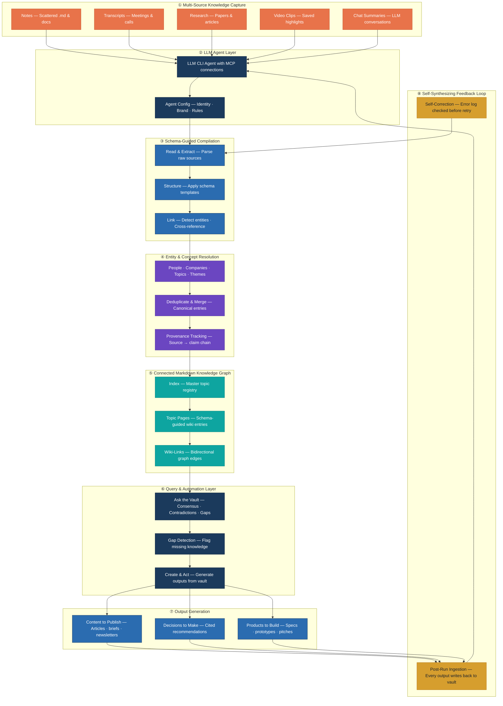

# Self-Synthesizing Second Brain — Reference Architecture

> **Pattern**: Multi-source knowledge capture → LLM-agent compilation → entity & concept resolution → connected Markdown knowledge graph → queryable vault with self-reinforcing feedback loop  
> **Stack**: LLM CLI Agent + MCP integrations · Markdown vault · Wiki-link graph · Obsidian / Notion (optional)  
> **Author**: [Suneeth Sreedharan](https://www.linkedin.com/in/suneethsreedharan/)

---

## Architecture Overview



---

## Pipeline Stages

### ① Multi-Source Knowledge Capture

Knowledge arrives in five formats — each captured somewhere different, none of it connected:

| Source | Type | Examples |
|--------|------|----------|
| Notes | Scattered .md & docs | Meeting notes, journal entries, ideas |
| Transcripts | Meetings & calls | Zoom recordings, podcast notes, voice memos |
| Research | Papers & articles | Academic papers, blog posts, industry reports |
| Video Clips | Saved highlights | Tutorial excerpts, conference talks, demos |
| Chat Summaries | LLM conversations | Claude / ChatGPT sessions, Slack threads |

The problem is not capture — it is **connection**. Each source lives in its own silo; nothing links, nothing accumulates, nothing gets smarter over time.

### ② LLM Agent Layer

An LLM CLI agent (with MCP connections to local and cloud tools) serves as the orchestration engine. The agent operates from a persistent configuration that encodes identity, brand voice, writing rules, and schema definitions — so every run produces consistent, structured output rather than ad-hoc answers.

### ③ Schema-Guided Compilation

The agent reads raw sources and applies schema templates to extract structured knowledge:

| Step | Action |
|------|--------|
| **Read & Extract** | Parse raw text from all source formats |
| **Structure** | Apply schema templates — topic, claim, source, date, confidence |
| **Link** | Detect entity mentions, cross-reference existing wiki entries |

### ④ Entity & Concept Resolution

Classic data-engineering problems — deduplication, entity matching, provenance — solved at the LLM layer:

| Step | Action |
|------|--------|
| **Entity extraction** | People, companies, topics, themes |
| **Deduplication** | Merge variant mentions into canonical entries |
| **Provenance tracking** | Every claim carries a source → claim chain |

### ⑤ Connected Markdown Knowledge Graph

The compiled knowledge lives in a **plain-Markdown vault** — portable, version-controlled, no vendor lock-in:

| Component | Purpose |
|-----------|---------|
| **Index** | Master topic registry — the entry point |
| **Topic pages** | Schema-guided wiki entries, one per concept |
| **Wiki-links** | Bidirectional `[[links]]` forming a navigable knowledge graph |

This follows the **Karpathy Wiki** pattern: three-layer sources → wiki → schema, set in agent configuration.

### ⑥ Query & Automation Layer

The vault becomes queryable — not just a static archive but an active knowledge base:

| Capability | What it does |
|------------|-------------|
| **Consensus** | Synthesizes what sources agree on — one clear, cited view |
| **Contradictions** | Surfaces where sources disagree, so conflicts are resolved deliberately |
| **Knowledge gaps** | Flags what is missing and the open questions worth pursuing next |
| **Reusable leverage** | One knowledge base powers articles, decisions, briefings and products |

### ⑦ Output Generation

Three classes of output — each grounded in cited vault knowledge, not ephemeral chat:

| Output | Description |
|--------|-------------|
| **Content to publish** | Articles, research briefs, newsletters |
| **Decisions to make** | Cited recommendations with source chains |
| **Products to build** | Specs, prototypes, pitch decks |

### ⑧ Self-Synthesizing Feedback Loop

Every answer and new capture **re-enters the loop** — the brain gets smarter with each pass:

| Mechanism | How it works |
|-----------|-------------|
| **Post-run ingestion** | Every run writes results back to the vault |
| **Self-correction** | Error log is checked before any retry |
| **Compounding** | New outputs become source material for future queries |

---

## Key Design Decisions

| Decision | Rationale |
|----------|-----------|
| **Plain Markdown vault** | No vendor lock-in — knowledge outlives any single tool or platform |
| **Schema-guided compilation** | Consistent structure across all sources; entities and claims are first-class objects |
| **Karpathy Wiki pattern** | Three-layer architecture (sources → wiki → schema) provides navigable depth |
| **Brand protocol** | All outputs follow a single brand-config file — consistent voice across every deliverable |
| **Post-run ingestion** | Outputs feed back as source material, enabling compounding knowledge over time |
| **Self-correction loop** | Error log checked before retry — failures inform the next pass instead of repeating |
| **Entity resolution at LLM layer** | Deduplication, linking and provenance are classic data problems now tractable at the agent layer |
| **Feedback loop, not linear pipeline** | Knowledge compounds — every query result enriches the vault for the next query |

---

## Why This Pattern Matters

The shift is from **LLM as answer engine** (temporary responses, forgotten after each session) to **LLM as persistent knowledge curator** (durable, linked, citable knowledge that compounds).

| Dimension | Answer Engine | Knowledge Curator |
|-----------|--------------|-------------------|
| **Persistence** | Ephemeral — gone after session | Durable — versioned Markdown vault |
| **Connections** | Answers never link | Wiki-links form a growing graph |
| **Provenance** | Sources vanish with chat | Every claim carries a source chain |
| **Compounding** | Starts from zero each time | Each pass enriches the next |

---

## Target Use Cases

| Audience | Application |
|----------|-------------|
| **Creators** | Writers, researchers and educators who turn accumulated knowledge into content |
| **Information businesses** | Newsletters, research shops and analysts who sell insight, not just information |
| **SMB knowledge teams** | Consultancies, agencies and small teams managing institutional knowledge |

Practical applications include auto research briefs, content repurposing, onboarding memory, and market intelligence.

---

## Technology Stack

| Layer | Options |
|-------|---------|
| LLM Agent | Claude Code / Cursor / Aider (CLI with MCP) |
| Agent Config | CLAUDE.md / system prompt + identity + brand rules |
| MCP Integrations | File system, Notion, Obsidian, web search, calendar |
| Knowledge Vault | Plain Markdown files (Git-versioned) |
| Wiki Graph | Obsidian / Logseq / any `[[wiki-link]]`-aware editor |
| Sync & Publish | Notion (optional cloud layer) |
| Output Formats | .md, .pptx, .docx, email drafts, task lists |

---

## First-Run Onboarding Sequence

```
1  Install skills & MCP connections
2  Build identity (soul.md — voice, values, expertise)
3  Brand setup (brand-config.md — palette, tone, formatting)
4  Ingest existing sources to wiki
5  Initialize cloud sync (Notion / equivalent)
6  Set up local vault (Obsidian / equivalent)
```

---

## Acknowledgements

Concepts and techniques in this architecture draw on learnings from:

- **Prof. Ryan Ahmed** — [The Complete Claude Code & Claude Cowork Masterclass](https://www.udemy.com/course/claude-aiagents-cowork-masterclass/) (Udemy) 

---

*Conceptual pattern — a blueprint for building a personal knowledge system, not a production product claim.*
